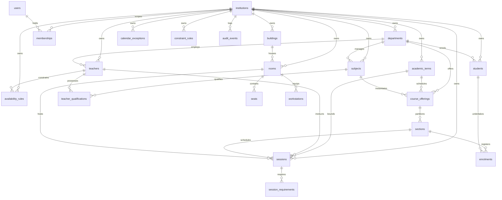

# Scheduler Core Relational Data Model (Phase 2)

## 1. Architectural Principles & Domain Concepts

The Scheduler relational schema is engineered to handle complex institutional timetabling, practical examination sittings, and theory examination seating across multi-tenant educational institutions.

### 1.1 Decoupled Identity vs. Institutional Membership
- **Global User Identity (`users`)**: Represents a person's authentication credentials (`email`, `hashed_password`, `full_name`, `is_active`). A single identity can theoretically belong to multiple institutions (e.g., adjunct faculty or cross-institution administrators).
- **Institution-Scoped Membership (`memberships`)**: Represents the user's role and authorization within a specific institution (`institution_id`, `role`, `department_id`, `is_active`). Roles include `INSTITUTION_ADMINISTRATOR`, `TIMETABLE_COORDINATOR`, `EXAM_CONTROLLER`, `TEACHER`, and `STUDENT`.

### 1.2 Multi-Tenant Safeguards & Composite Foreign Keys
- **Explicit Tenant Ownership**: Every institution-owned entity carries an explicit `institution_id` column.
- **Tenant-Scoped Uniqueness**: Natural keys (such as department codes, subject codes, student roll numbers, employee IDs, room numbers, and seat codes) are unique only within the scope of the tenant (e.g., `UNIQUE(institution_id, code)`).
- **Composite Foreign Key Safeguards**: To eliminate cross-tenant data corruption at the database engine level, relationships between tenant-owned entities enforce composite foreign keys referencing both `(id, institution_id)`:
  ```sql
  CONSTRAINT fk_subjects_department_tenant
  FOREIGN KEY (department_id, institution_id)
  REFERENCES departments(id, institution_id)
  ON DELETE CASCADE
  ```
  Attempting to link an entity in Tenant A to a parent in Tenant B is physically rejected by the database engine.

### 1.3 Physical Capacity vs. Usable Exam Benches
- **Physical Capacity (`rooms.physical_capacity`)**: The nominal architectural or fire-code capacity for standard instructional classes.
- **Usable Exam Benches (`rooms.usable_exam_benches`)**: The number of isolated, anti-cheating compliant benches available during formal examination sittings. This is typically lower than physical capacity to guarantee single-candidate spacing.

### 1.4 Theory Bench vs. Practical Workstation
- **Theory Bench (`seats`)**: Physical desk or examination bench in a room. Carries coordinates (`row_number`, `column_number`), bench codes, and operational status (`USABLE`, `BLOCKED`, `ACCESSIBLE` for candidates requiring accommodations).
- **Practical Workstation (`workstations`)**: Specialized laboratory computer or terminal with distinct hardware/software attributes (`os_family`, JSON `features` such as GPU, MATLAB, Dual Monitor, Oscilloscope).

### 1.5 Recurring Academic Patterns vs. Dated Calendar Exceptions
- **Recurring Patterns (`sessions.is_recurring = True`)**: Standard weekly academic timetable blocks defined by `day_of_week` (0=Monday ... 6=Sunday), `start_time`, and `end_time`.
- **Dated Sessions (`sessions.is_recurring = False`)**: Specific dated occurrences such as practical exam sittings and theory exam sittings defined by timezone-aware `start_datetime` and `end_datetime`.
- **Calendar Exceptions (`calendar_exceptions`)**: Explicit overrides (holidays, blackout dates, maintenance windows, exam periods) that suppress or modify the recurring weekly calendar.

### 1.6 Student Section vs. Actual Enrolment
- **Section (`sections`)**: Institutional cohort or class division (e.g., "Section A", "Lab Batch B1") created under a course offering with target capacity.
- **Enrolment (`enrolments`)**: The binding between an individual student and a section, with status (`ENROLLED`, `WAITLISTED`, `DROPPED`, `COMPLETED`).

### 1.7 Instructor Eligibility vs. Assigned Instructor
- **Instructor Eligibility (`teacher_qualifications`)**: Declares whether a teacher is certified and qualified to teach a specific subject, distinguishing theory vs. practical competencies.
- **Assigned Instructor (`sessions.primary_teacher_id`)**: The actual teacher assigned to conduct a particular scheduled lecture, lab, or exam invigilation duty.

### 1.8 Explicit Term Timezone Handling
- Each academic term explicitly defines its IANA timezone (`academic_terms.timezone`, e.g., `UTC`, `Asia/Kolkata`, `America/New_York`).
- All timestamps (`created_at`, `updated_at`, `start_datetime`, `end_datetime`) are stored as UTC in the database with timezone awareness.
- Timezone conversions are handled strictly through the centralized utility `app.core.timezone`—no ad-hoc local time math is scattered throughout business logic.

---

## 2. Entity-Relationship Diagram



---

## 3. Entity Catalog

### 3.1 Tenancy & Identity

#### `institutions`
- `id` (UUID, PK)
- `name` (String, Not Null)
- `code` (String, Unique, Not Null)
- `timezone` (String, Default: "UTC")
- `is_active` (Boolean, Default: True)
- `created_at`, `updated_at` (DateTime, UTC)

#### `users`
- `id` (UUID, PK)
- `email` (String, Unique, Not Null)
- `hashed_password` (String, Not Null)
- `full_name` (String, Not Null)
- `is_active` (Boolean, Default: True)
- `created_at`, `updated_at` (DateTime, UTC)

#### `memberships`
- `id` (UUID, PK)
- `user_id` (UUID, FK -> `users.id`)
- `institution_id` (UUID, FK -> `institutions.id`)
- `role` (Enum: `INSTITUTION_ADMINISTRATOR`, `TIMETABLE_COORDINATOR`, `EXAM_CONTROLLER`, `TEACHER`, `STUDENT`)
- `department_id` (UUID, Nullable, Composite FK -> `departments(id, institution_id)`)
- `is_active` (Boolean, Default: True)
- `created_at`, `updated_at` (DateTime, UTC)
- *Constraints*: `UNIQUE(user_id, institution_id)`

---

### 3.2 Academic Structure

#### `departments`
- `id` (UUID, PK)
- `institution_id` (UUID, FK -> `institutions.id`)
- `name` (String, Not Null)
- `code` (String, Not Null)
- *Constraints*: `UNIQUE(id, institution_id)`, `UNIQUE(institution_id, code)`

#### `academic_terms`
- `id` (UUID, PK)
- `institution_id` (UUID, FK -> `institutions.id`)
- `name` (String, Not Null)
- `code` (String, Not Null)
- `start_date` (Date, Not Null)
- `end_date` (Date, Not Null)
- `timezone` (String, Default: "UTC")
- `is_active` (Boolean, Default: True)
- *Constraints*: `UNIQUE(id, institution_id)`, `UNIQUE(institution_id, code)`

#### `subjects`
- `id` (UUID, PK)
- `institution_id` (UUID, FK -> `institutions.id`)
- `department_id` (UUID, Composite FK -> `departments(id, institution_id)`)
- `name` (String, Not Null)
- `code` (String, Not Null)
- `subject_type` (Enum: `THEORY`, `PRACTICAL`, `INTEGRATED`)
- `credits` (Integer, Default: 3)
- `weekly_lecture_hours`, `weekly_lab_hours` (Integer)
- *Constraints*: `UNIQUE(id, institution_id)`, `UNIQUE(institution_id, code)`

#### `course_offerings`
- `id` (UUID, PK)
- `institution_id` (UUID, FK -> `institutions.id`)
- `subject_id` (UUID, Composite FK -> `subjects(id, institution_id)`)
- `term_id` (UUID, Composite FK -> `academic_terms(id, institution_id)`)
- `department_id` (UUID, Composite FK -> `departments(id, institution_id)`)
- `is_active` (Boolean, Default: True)
- *Constraints*: `UNIQUE(id, institution_id)`, `UNIQUE(institution_id, subject_id, term_id)`

#### `sections`
- `id` (UUID, PK)
- `institution_id` (UUID, FK -> `institutions.id`)
- `offering_id` (UUID, Composite FK -> `course_offerings(id, institution_id)`)
- `name` (String, Not Null)
- `code` (String, Not Null)
- `capacity` (Integer, Default: 60)
- *Constraints*: `UNIQUE(id, institution_id)`, `UNIQUE(institution_id, offering_id, code)`

#### `enrolments`
- `id` (UUID, PK)
- `institution_id` (UUID, FK -> `institutions.id`)
- `section_id` (UUID, Composite FK -> `sections(id, institution_id)`)
- `student_id` (UUID, Composite FK -> `students(id, institution_id)`)
- `status` (Enum: `ENROLLED`, `WAITLISTED`, `DROPPED`, `COMPLETED`)
- *Constraints*: `UNIQUE(institution_id, section_id, student_id)`

---

### 3.3 People & Qualifications

#### `teachers`
- `id` (UUID, PK)
- `institution_id` (UUID, FK -> `institutions.id`)
- `user_id` (UUID, FK -> `users.id`)
- `department_id` (UUID, Composite FK -> `departments(id, institution_id)`)
- `employee_id` (String, Not Null)
- `max_weekly_hours` (Integer, Default: 20)
- *Constraints*: `UNIQUE(id, institution_id)`, `UNIQUE(institution_id, employee_id)`

#### `teacher_qualifications`
- `id` (UUID, PK)
- `institution_id` (UUID, FK -> `institutions.id`)
- `teacher_id` (UUID, Composite FK -> `teachers(id, institution_id)`)
- `subject_id` (UUID, Composite FK -> `subjects(id, institution_id)`)
- `can_teach_theory`, `can_teach_practical` (Boolean, Default: True)
- *Constraints*: `UNIQUE(institution_id, teacher_id, subject_id)`

#### `students`
- `id` (UUID, PK)
- `institution_id` (UUID, FK -> `institutions.id`)
- `user_id` (UUID, FK -> `users.id`)
- `department_id` (UUID, Composite FK -> `departments(id, institution_id)`)
- `roll_number` (String, Not Null)
- `batch_year` (Integer, Not Null)
- *Constraints*: `UNIQUE(id, institution_id)`, `UNIQUE(institution_id, roll_number)`

---

### 3.4 Facilities, Rooms & Equipment

#### `buildings`
- `id` (UUID, PK)
- `institution_id` (UUID, FK -> `institutions.id`)
- `name` (String, Not Null)
- `code` (String, Not Null)
- *Constraints*: `UNIQUE(id, institution_id)`, `UNIQUE(institution_id, code)`

#### `rooms`
- `id` (UUID, PK)
- `institution_id` (UUID, FK -> `institutions.id`)
- `building_id` (UUID, Composite FK -> `buildings(id, institution_id)`)
- `room_number` (String, Not Null)
- `name` (String, Not Null)
- `room_type` (Enum: `LECTURE_HALL`, `CLASSROOM`, `COMPUTER_LAB`, `SCIENCE_LAB`, `WORKSHOP`)
- `physical_capacity` (Integer, Not Null) - Architectural max headcount
- `usable_exam_benches` (Integer, Not Null) - Examination seating capacity
- `is_active` (Boolean, Default: True)
- *Constraints*: `UNIQUE(id, institution_id)`, `UNIQUE(institution_id, building_id, room_number)`

#### `seats`
- `id` (UUID, PK)
- `institution_id` (UUID, FK -> `institutions.id`)
- `room_id` (UUID, Composite FK -> `rooms(id, institution_id)`)
- `seat_code` (String, Not Null)
- `row_number`, `column_number` (Integer, Not Null)
- `is_usable` (Boolean, Default: True)
- `is_accessible` (Boolean, Default: False) - Accessible bench for candidates with disabilities
- `is_blocked` (Boolean, Default: False) - Physically damaged or quarantined bench
- *Constraints*: `UNIQUE(id, institution_id)`, `UNIQUE(institution_id, room_id, seat_code)`

#### `workstations`
- `id` (UUID, PK)
- `institution_id` (UUID, FK -> `institutions.id`)
- `room_id` (UUID, Composite FK -> `rooms(id, institution_id)`)
- `workstation_code` (String, Not Null)
- `os_family` (String, e.g., "Linux", "Windows 11")
- `features` (JSON, e.g., {"gpu": "RTX 4080", "matlab": true, "ram_gb": 32})
- `is_functional` (Boolean, Default: True)
- *Constraints*: `UNIQUE(id, institution_id)`, `UNIQUE(institution_id, room_id, workstation_code)`

---

### 3.5 Sessions, Rules & Constraints

#### `sessions`
- `id` (UUID, PK)
- `institution_id` (UUID, FK -> `institutions.id`)
- `term_id` (UUID, Composite FK -> `academic_terms(id, institution_id)`)
- `section_id` (UUID, Nullable, Composite FK -> `sections(id, institution_id)`)
- `subject_id` (UUID, Composite FK -> `subjects(id, institution_id)`)
- `room_id` (UUID, Nullable, Composite FK -> `rooms(id, institution_id)`)
- `primary_teacher_id` (UUID, Nullable, Composite FK -> `teachers(id, institution_id)`)
- `session_type` (Enum: `LECTURE`, `LAB`, `TUTORIAL`, `PRACTICAL_EXAM`, `THEORY_EXAM`)
- `status` (Enum: `DRAFT`, `CHECKED`, `REVIEWED`, `PUBLISHED`, `CANCELLED`)
- `is_recurring` (Boolean, Default: True)
- `day_of_week` (Integer: 0-6, Nullable for dated exams)
- `start_time`, `end_time` (Time, Nullable for dated exams)
- `start_datetime`, `end_datetime` (DateTime UTC with timezone, for dated exams)
- *Constraints*: `UNIQUE(id, institution_id)`

#### `availability_rules`
- `id` (UUID, PK)
- `institution_id` (UUID, FK -> `institutions.id`)
- `target_type` (Enum: `TEACHER`, `ROOM`, `SECTION`)
- `target_id` (UUID, Not Null)
- `day_of_week` (Integer, 0-6)
- `start_time`, `end_time` (Time)
- `is_available` (Boolean, Default: True) - True for available window; False for blackout
- `priority` (Integer, Default: 1)

#### `calendar_exceptions`
- `id` (UUID, PK)
- `institution_id` (UUID, FK -> `institutions.id`)
- `name` (String, Not Null)
- `exception_type` (Enum: `HOLIDAY`, `EXAM_PERIOD`, `MAINTENANCE`, `CUSTOM`)
- `start_date`, `end_date` (Date, Not Null)
- `department_id` (UUID, Nullable, Composite FK -> `departments(id, institution_id)`)
- `room_id` (UUID, Nullable, Composite FK -> `rooms(id, institution_id)`)

#### `session_requirements`
- `id` (UUID, PK)
- `institution_id` (UUID, FK -> `institutions.id`)
- `session_id` (UUID, Composite FK -> `sessions(id, institution_id)`)
- `min_seats` (Integer, Default: 1)
- `requires_computers` (Boolean, Default: False)
- `required_os` (String, Nullable)
- `required_features` (JSON, Default: {})

#### `constraint_rules`
- `id` (UUID, PK)
- `institution_id` (UUID, FK -> `institutions.id`)
- `name` (String, Not Null)
- `rule_type` (Enum: `HARD`, `SOFT`)
- `category` (String, e.g., "FACULTY_LOAD", "ROOM_CAPACITY", "STUDENT_CLASH")
- `parameters` (JSON, Default: {})
- `weight` (Integer, Default: 100)
- `is_active` (Boolean, Default: True)

---

### 3.6 Audit Logging

#### `audit_events`
- `id` (UUID, PK)
- `institution_id` (UUID, Nullable, FK -> `institutions.id`)
- `user_id` (UUID, Nullable, FK -> `users.id`)
- `action` (String, Not Null, e.g., `TIMETABLE_PUBLISHED`, `ROOM_BLOCKED`)
- `resource_type` (String, Not Null)
- `resource_id` (String, Nullable)
- `details` (JSON, Default: {})
- `ip_address` (String, Nullable)
- `created_at` (DateTime, UTC, Not Null)
